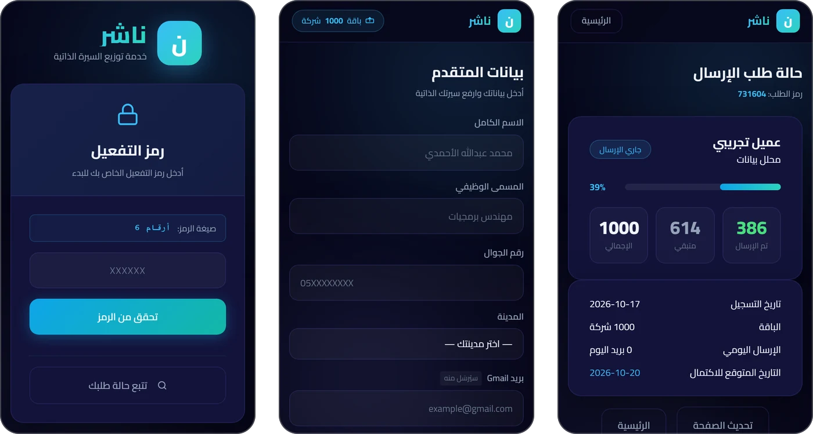
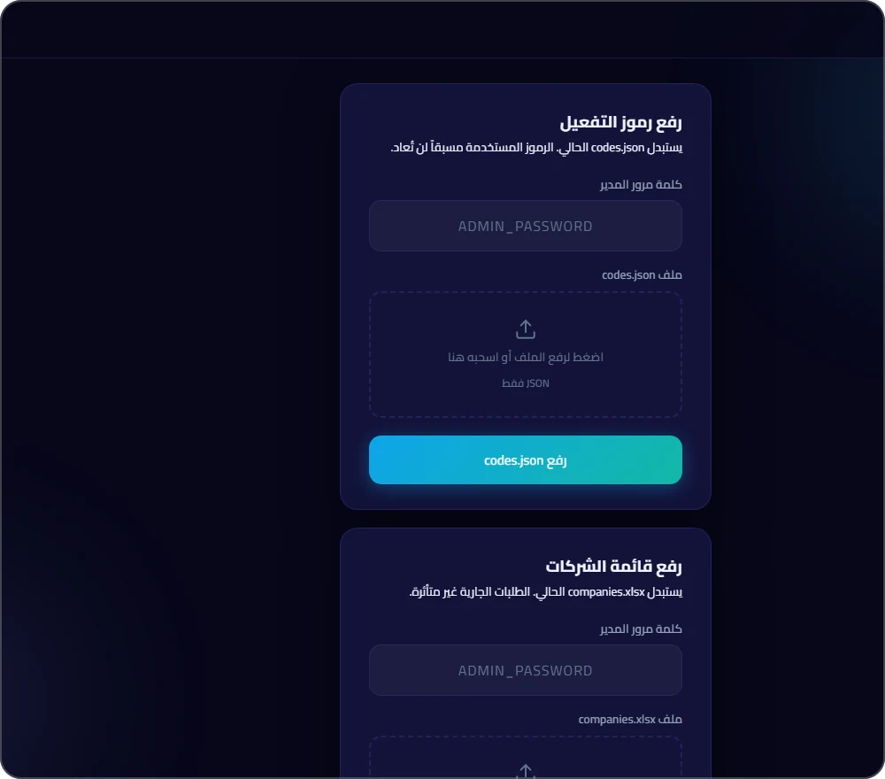

# Nasher (ناشر)

**A self-service SaaS that sent job seekers' CVs to hundreds of Saudi HR inboxes, from the job seeker's own Gmail account.**



## The problem

Job hunting in Saudi Arabia often means emailing your CV to hundreds of companies one by one, if you can even find the right HR address. Most job seekers give up after a few dozen.

## The solution

Clients bought a package of 500–2,000 companies. Everything after the purchase was automatic:

- **Activation codes.** Each purchase generated a one-time code, delivered on WhatsApp.
- **Self-onboarding.** The client entered the code, uploaded a CV, wrote the email subject and body, and connected their own Gmail account with an app password.
- **Background sending.** Each CV went out as an individual email, spaced out over time, from the client's own address.
- **Live status page.** Sent, remaining and expected completion, per client.
- **Admin panel.** Upload activation codes and replace the company list.

## Key results

- **25 paying clients in 2 weeks** from TikTok ads.
- **17,000+ automated emails** sent.
- **2,107 verified HR contacts** across **900+ companies** and **52 sectors**, built with Apollo.io, verified with ZeroBounce, and extended with a Python scraper ([email-finder](https://github.com/Abdullah-Albariqi/email-finder)).

### Why it's paused

I tracked clients' reply and interview rates after each send. The outcomes weren't strong enough to justify the price, so I shut Nasher down voluntarily, even though it was selling. A product that sells but doesn't deliver isn't worth scaling.

## How it works

```
Salla order ──webhook──▶ n8n ──▶ activation code ──▶ WhatsApp to client
                                                          │
                                                          ▼
                     Client self-onboards on the Nasher web app (Flask)
                     code → CV upload → subject/body → Gmail app password
                                                          │
                                                          ▼
              Background sender (one SMTP session, spaced sends, progress saved per email)
                                                          │
                                                          ▼
                              Live status page · admin panel
```

## v1 → v2

| | v1: [Nasher CLI](https://github.com/Abdullah-Albariqi/nasher-cli) | v2: Nasher web app |
|---|---|---|
| Who runs it | Me, by hand, for each client | The client, self-service |
| Interface | Terminal prompts | Web dashboard (Arabic, RTL) |
| Onboarding | I collected the CV and details manually | Activation code → onboarding form |
| Payment link | None | Salla webhook → n8n → WhatsApp |
| Tracking | Console log | Live status page + admin panel |

v1 proved people would pay. v2 removed me from the loop, so it could scale on ad spend alone.

## Tech stack

Python · Flask · SQLAlchemy (SQLite) · Gmail SMTP · n8n · WhatsApp Cloud API · Railway (gunicorn)

## Screenshots



*Activation, onboarding, status and admin screens, all shown with invented demo data.*

## Status

⏸️ **Paused** (ran May–June 2026)

---

Source code is private and available on request. More about me: [Abdullah-Albariqi](https://github.com/Abdullah-Albariqi)
